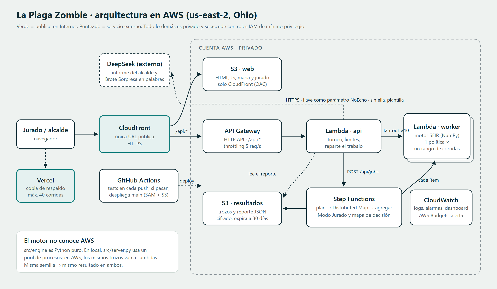

# La Plaga Zombie · Manta

**SpookyThon 2026 · Track B.** Herramienta del Comité de Contención de Manta: simula día a día cómo se propaga una plaga en una red de contactos de la ciudad, reparte vacunas escasas con distintas estrategias y demuestra con cientos de corridas pareadas cuánta gente salva cada una frente a **no hacer nada** y frente a **vacunar al azar con las mismas dosis**.

> URL pública en AWS: _pendiente de despliegue (falta la cuenta con Budget)_ · Vista previa en Vercel: **https://plaga-zombie-manta.vercel.app** (máx. 40 corridas por petición; el ataque en vivo del Modo Jurado solo corre en AWS o en local)

**Pitch (PDF, 10 diapositivas):** [docs/pitch/pitch-plaga-zombie.pdf](docs/pitch/pitch-plaga-zombie.pdf)



## Qué la hace distinta

1. **Torneo con números aleatorios comunes.** Nada, Azar y cuatro estrategias corren con exactamente la misma suerte (quién se cruza con quién, cuánto dura cada etapa, a quién se detecta). Se compara **corrida por corrida**: personas salvadas con su rango y **en cuántas semillas gana** (la tira de 100 marcas de la interfaz).
2. **Modo Jurado (red team automático).** Un atacante prueba decenas de brotes sorpresa (R0, dosis, eficacia, lugar de inicio, retraso de detección) buscando dónde perdemos contra Azar. Resultado: una regla fija como «Anillo + conectados» **pierde cuando R0 ≥ 2,3**; el **torneo automático**, que elige con semillas de entrenamiento y se juzga con semillas nuevas, **no pierde en ninguno** (los empates son brotes donde ninguna vacuna cambia nada). Detalle en [docs/decisiones.md](docs/decisiones.md).
3. **Mapa de decisión precalculado.** 72 condiciones con su mejor estrategia: en el Brote Sorpresa la respuesta aparece al instante y luego se confirma con la semilla del jurado.
4. **Realismo de información.** El comité solo ve los Zombies **detectados** (60 %, con 2 días de retraso). No ve a los Mordidos. Las dosis que se pierden en ellos se muestran, no se esconden.
5. **Calibrado con datos reales de Manta.** El exceso de muertes de 2020 (Registro Civil) muestra que la primera ola crecía 8,4 % por día; el modelo reproduce ese crecimiento con **R0 = 2,35** y la forma de la ola coincide (5 semanas sobre la mitad del pico en la realidad, 4 en el modelo).
6. **Evidencia real frente a ficción.** El mismo motor corre COVID-19 Manta 2020, influenza 2009 y tres plagas inspiradas en el cine de zombis (el zombi lento, con parámetros de [Alemi et al. 2015](https://arxiv.org/abs/1503.01104); los caminantes y la horda rápida). Cada una pide una estrategia distinta.
7. **Mapa animado de Manta.** Vuelo de Ecuador a Manta y, día por día, cada persona mordida de la **corrida típica** (la mediana de personas salvadas) se enciende sobre el mapa real, con contadores y titulares de lo que pasa en la corrida ("la plaga llega a Tarqui", "ya va el 25 % de la ciudad"…). Se compara sin intervenir, azar y la estrategia.
8. **Intro con música propia.** La banda sonora (zumbido grave, latido y viento) se genera en vivo en el navegador con Web Audio: no usa archivos ni música con derechos. El latido se acelera cuando la ciudad se llena de zombis.
9. **Cierres con presupuesto (nivel Pro).** Además de vacunar, el comité puede cerrar el mercado o los colegios mientras vea suficientes casos, pagando cada día de cierre del mismo presupuesto que las dosis. La interfaz compara los cuatro planes (solo vacunas, mercado, colegios, ambos) con las mismas semillas y recomienda el mejor: cerrar colegios rinde mucho; cerrar el mercado, casi nada.
10. **Certificado de reproducibilidad.** Hash de la configuración, semilla, versión del motor y commit, y un enlace "repetir" con toda la configuración en la URL.

## El modelo en un minuto

- **Población:** Manta sintética de **10 000 agentes** (1 agente = 27,1 personas de los 271 145 del Censo 2022) con edades del censo, hogares de 3,2 personas, aulas de 30, trabajos de 10, bus, mercado central con vendedores y 10 barrios.
- **Plaga:** SEIR estocástico sobre la red: Sano → Mordido (≈ 3 días, no contagia) → Zombie (≈ 5 días, contagia) → Exorcizado. Inspirada en influenza y COVID-19.
- **Contagio:** cada día, un Sano con Zombies cerca se contagia con probabilidad `1 − Π (1 − β·w)`, donde *w* depende del lugar (hogar 1, colegio y trabajo 0,2, bus y mercado 0,05, barrio 0,02). β se **calibra** para que el R0 elegido se cumpla.
- **Intervención:** *K* vacunas por día desde el día 7, con eficacia configurable. Solo se vacuna a quien no está vacunado ni detectado.
- **Estrategias candidatas:** Más conectados, Conocido (acquaintance), Anillo, Anillo + conectados. **Recomendar** las corre todas y elige la que más salva en la corrida típica (mediana).

Todos los supuestos, con fuente: **[docs/supuestos.md](docs/supuestos.md)**.

## Parámetros por defecto y semilla

| Parámetro | Valor |
|---|---|
| Semilla del jurado (`seed`) | **2026** |
| Semilla de la ciudad (`city_seed`) | **2026** |
| Agentes | 10 000 |
| Corridas por política | 100 |
| Días | 150 |
| R0 | 2,0 |
| Latencia / días contagioso | 3 / 5 (gamma, forma 4) |
| Casos iniciales | 5, en cualquier lugar |
| Vacunas | 20 por día desde el día 7 |
| Eficacia | 90 % |
| Detección | 60 % de los Zombies, 2 días después |
| Estrategia | automática (torneo) |

Con estos valores y la semilla 2026: «Anillo + conectados» evita en promedio **3 922** contagios frente a no hacer nada y **2 697** frente a Azar, y gana a Azar en **95 de 100** semillas. Cualquiera lo reproduce con `?seed=2026` o con el botón **Copiar enlace para repetir**.

Presets de Brote Sorpresa (un toque en la interfaz): el doble de contagiosa (R0 4,0), la mitad de las vacunas (10/día), empieza en el mercado, variante que la vacuna cubre a medias (eficacia 50 %).

## Checklist de requisitos DEBE

| # | Requisito | Estado | Evidencia |
|---|---|---|---|
| 1 | Simular día a día | ✅ | `src/engine/seir.py` (bucle diario); prueba S+E+I+R+V = N cada día |
| 2 | Intervención con recursos limitados | ✅ | *K* vacunas/día y cierres pagados de un presupuesto total; prueba "el presupuesto nunca se excede" |
| 3 | Comparar contra no intervenir y azar | ✅ | Torneo con Nada y Azar en las mismas semillas; tarjetas "frente a no hacer nada / al azar" |
| 4 | Muchas corridas, promedios y rangos | ✅ | 100 corridas por política (40 en Vercel); promedio, rango del 90 % e IC 95 % en la interfaz |
| 5 | Interfaz para cambiar contagio, vacunas e inicio | ✅ | Controles R0, vacunas por día y "Dónde empieza", más los presets de Brote Sorpresa |
| 6 | Reproducible | ✅ | Misma config + semilla ⇒ mismo JSON byte a byte (prueba) y mismo hash en local y en Vercel |
| 7 | Desplegado en AWS | ⏳ **Pendiente** | `infra/template.yaml` y `scripts/deploy_aws.sh` listos (`sam validate --lint` pasa); falta la cuenta del equipo con Budget |
| 8 | README con supuestos y fuentes | ✅ | Este README y [docs/supuestos.md](docs/supuestos.md) |

Regla de la cuenta: el **AWS Budget con alerta** (captura abajo) también está pendiente, junto con el punto 7.

## Cómo correrlo en local

Requisitos: Python 3.12 o 3.13.

```bash
python -m venv .venv
.venv/Scripts/activate            # Windows (en Linux/macOS: source .venv/bin/activate)
pip install numpy pytest boto3
python src/server.py              # http://localhost:8000
```

Opcional, para regenerar los datos reales, el mapa de decisión, el Modo Jurado, la calibración y los escenarios (≈ 12 minutos en 12 núcleos):

```bash
python scripts/build_covid_manta.py   # exceso de muertes de Manta (ecuacovid, MIT)
python scripts/precompute.py          # map, jury, real, fiction
```

## Cómo probarlo

```bash
python -m pytest
```

49 pruebas, entre ellas:

| Prueba | Qué garantiza |
|---|---|
| Misma configuración y semilla ⇒ mismo JSON byte a byte | Reproducibilidad |
| Repartir las corridas en 1 o en 6 trozos da lo mismo | Que local y AWS den lo mismo |
| S + E + I + R + V = N todos los días | No se pierde ni se crea gente |
| Nunca se vacuna a un detectado ni dos veces a la misma persona | La trampa que busca el jurado |
| Azar y la estrategia reciben las mismas dosis cada día | Comparación justa |
| R0 = 0 ⇒ nadie más se contagia; vacunar a todos ⇒ no hay brote | Sanidad del modelo |
| R0 calibrado = R0 simulado día a día (±10 %) | Calibración correcta |
| Modo Jurado reproducible y rutas de la API | Robustez del producto |
| La tasa de crecimiento se recupera exacta en una curva conocida; los datos de Manta muestran la ola de 2020 | Calibración con datos reales |
| Los puntos del mapa caen dentro de Manta y las vacunas aparecen desde el día de llegada | Mapa fiel a la simulación |
| El presupuesto nunca se excede; "Nada" nunca cierra; cerrar colegios salva gente con las mismas semillas | Cierres y presupuesto |
| NaN o infinito en la API ⇒ 400; semillas fuera de rango se acotan | API pública robusta |

## Cómo desplegarlo en AWS

Requisitos: cuenta de AWS **con AWS Budget y alerta** (ver abajo), AWS CLI con un perfil propio (`aws configure sso`; nunca llaves en el repositorio) y AWS SAM CLI. Región: **us-east-1**.

```bash
AWS_PROFILE=<tu-perfil> bash scripts/deploy_aws.sh
```

El script muestra la cuenta y pide confirmación, construye la capa de numpy para Linux (sin Docker), hace `sam build` y `sam deploy`, sube `src/web` a S3, invalida CloudFront y prueba `/`, `/api/meta` y `/api/simulate` en la URL pública. Verificado en local: `sam validate --lint` y `sam build` pasan (cada función pesa 1,7 MB; numpy va en la capa).

AWS Budget con alerta (una vez, antes de desplegar; luego tomar la captura en la consola de Billing → Budgets):

```bash
aws budgets create-budget --account-id <ID_DE_CUENTA>   --budget '{"BudgetName":"plaga-zombie","BudgetLimit":{"Amount":"10","Unit":"USD"},"TimeUnit":"MONTHLY","BudgetType":"COST"}'   --notifications-with-subscribers '[{"Notification":{"NotificationType":"ACTUAL","ComparisonOperator":"GREATER_THAN","Threshold":50,"ThresholdType":"PERCENTAGE"},"Subscribers":[{"SubscriptionType":"EMAIL","Address":"<CORREO>"}]}]'
```

Antes de desplegar, revisar en **Service Quotas** la concurrencia de Lambda de la cuenta: en cuentas nuevas puede ser baja. Si es menor a 50, bajar `MaxFanout` y `MapMaxConcurrency` en `sam deploy` o pedir un aumento.

Seguridad: buckets privados (la web solo se lee desde CloudFront con OAC), un rol por función con el mínimo permiso (SAM policy templates), API con throttling y límites de parámetros en el motor, resultados cifrados y con expiración.

### AWS Budget


_Pendiente: captura del Budget con alerta creado por el equipo._

## Costos

Resumen: **≈ USD 0,003 por "Recomendar"**, ≈ USD 0,06 por ataque del Modo Jurado y **≈ USD 0,25/mes** con la capa gratuita para el uso del evento. Cálculo completo y gasto real: [docs/costos.md](docs/costos.md).

## Estructura

```
src/engine/       motor en Python puro (no conoce AWS)
  config.py         parámetros, límites y hash
  population.py     Manta sintética y red de contactos (CSR)
  disease.py        duraciones y contagio diario
  calibrate.py      β ↔ R0
  seir.py           simulación SEIR con números aleatorios comunes
  strategies.py     Nada, Azar y las cuatro estrategias
  montecarlo.py     corridas pareadas, estadísticas y torneo
  jury.py           Modo Jurado (red team)
  decision_map.py   mapa de decisión
  realdata.py       calibración con el exceso de muertes de Manta 2020
  scenarios.py      escenarios reales y de ficción con su fuente
  api.py            casos de uso (simular, metadatos, mapa, certificado)
src/handlers/     adaptadores de AWS Lambda (api, worker, jobs)
src/server.py     servidor local
src/web/          interfaz (HTML + JS + Chart.js) y datos precalculados
app.py            adaptador de Vercel (vista previa, WSGI)
data/             datos reales procesados (Manta 2020)
infra/            AWS SAM: template, Step Functions y capa de numpy
tests/            pytest
docs/             supuestos, decisiones, costos y arquitectura
```

## Limitaciones (dichas con honestidad)

- **Ciudad sintética:** las proporciones salen del censo, pero la red de contactos es inventada con supuestos razonables; no son datos de movilidad reales de Manta.
- **R0 de un caso al azar:** en una red, los casos de las generaciones siguientes suelen estar más conectados, así que el crecimiento real del brote es algo mayor que el R0 nominal.
- **Vacuna simplificada:** todo o nada, protege desde el mismo día y no se pierde con el tiempo.
- **Sin muertes, hospitales ni cambios de comportamiento** (la gente no se encierra sola al ver casos).
- **Intervenciones acotadas:** vacunas y cierres de mercado o colegios con presupuesto. No hay cuarentenas individuales ni rastreo de contactos más allá del anillo.
- **Sesgo del ganador:** Recomendar elige la estrategia con las mismas semillas con las que reporta su ventaja, así que la cifra "frente a Azar" es algo optimista cuando dos estrategias quedan cerca. El Modo Jurado evita esto con semillas de entrenamiento y de prueba separadas.
- **Escala 1 : 27:** con 10 000 agentes, los números "en Manta" son una extrapolación lineal.

## Créditos

Equipo Comité de Contención · Mineral Studio · SpookyThon 2026 · ULEAM. Datos de defunciones: Registro Civil del Ecuador vía [ecuacovid](https://github.com/andrab/ecuacovid) (MIT). Mapas: Esri, HERE, Garmin y colaboradores de OpenStreetMap.
